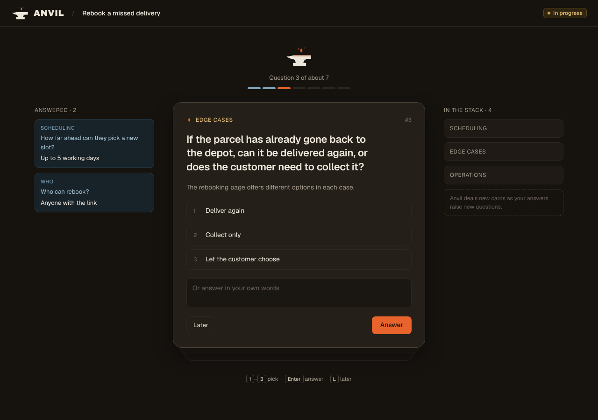
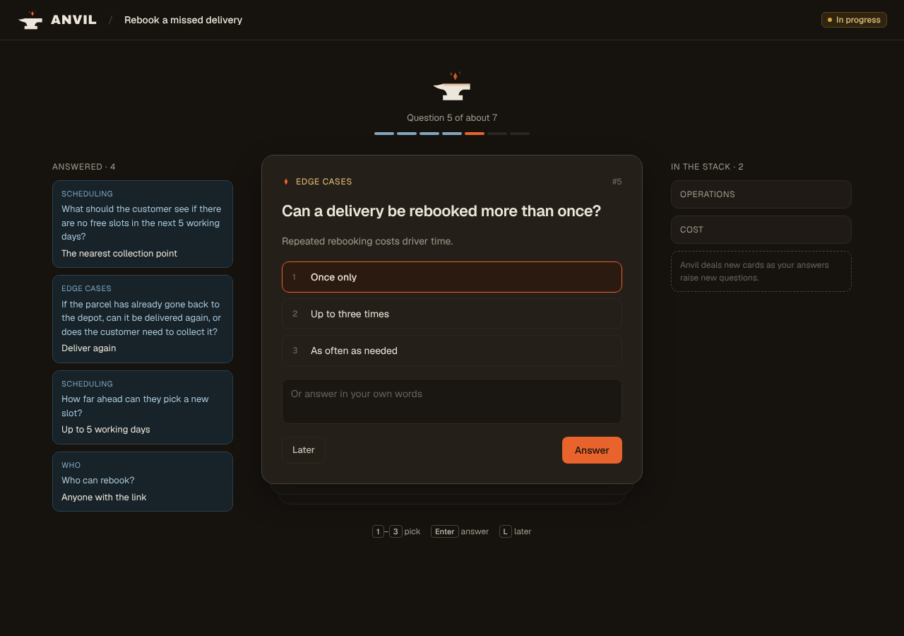
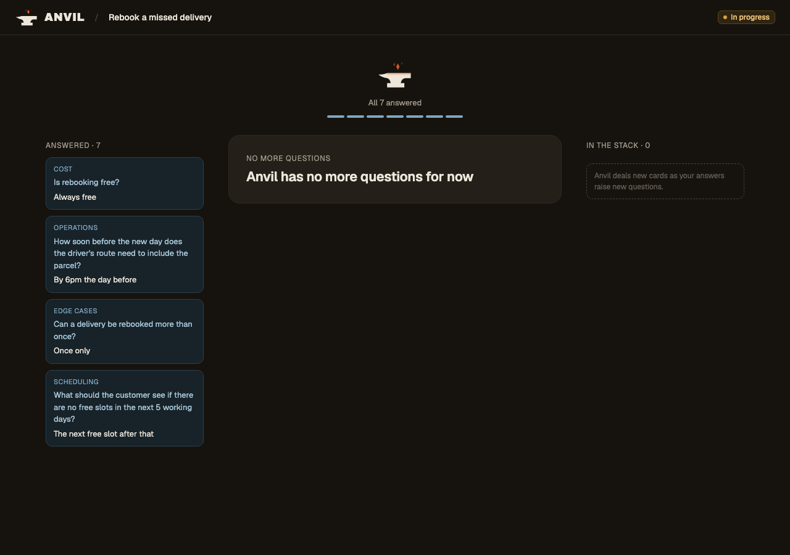

# Design

The source of truth for how Anvil looks. UI work should match this folder; when the design changes, update it here in the same PR.

The values themselves live in the app, so there's one copy: colours, fonts, type sizes, radii and the content container in [`frontend/src/theme.css`](../../frontend/src/theme.css), the logo in [`frontend/src/assets/`](../../frontend/src/assets/) and the favicon in [`frontend/public/`](../../frontend/public/). This page explains what they're for; change a value there, not here.

The UI is built on [shadcn/ui](https://ui.shadcn.com) and Tailwind, dark mode only for now, themed with the **Forge** palette below.

## Logo

| File | Use |
|---|---|
|  [`logo.svg`](../../frontend/src/assets/logo.svg) | The main mark: an anvil with three sparks. Use it in the app header next to the wordmark. |
|  [`favicon.svg`](../../frontend/public/favicon.svg) | The browser tab icon: the same anvil with a single spark. It switches the anvil to iron on light browser themes. |

The sparks are separate elements (`spark-1` to `spark-3`, hottest first) so they can be animated later. Don't merge them into one path.

**Wordmark:** `ANVIL` in heavy Archivo, slightly tracked, in ash, with the mark to its left. The wordmark is the only place Archivo is used.

## Colour

The palette is the shadcn CSS variables in `theme.css`. The named ones:

- **Iron** (`--background`): the page.
- **Ash** (`--foreground`): text.
- **Soot** (`--muted`, `--secondary`): tab list, progress track, avatar.
- **Ember** (`--primary`, `--ring`): the one primary action per screen, and focus rings.

Keep ember for the primary action, focus and the logo's sparks. Don't use it for status.

### Status

Each status is a badge with a coloured dot, and the same colour fills the card's progress bar. The statuses are Draft, In progress and Complete, each with its own dot, badge background, badge border and badge text colour (`--status-*` in `theme.css`).

## Type

- **UI text:** [Geist](https://fonts.google.com/specimen/Geist).
- **Wordmark only:** [Archivo](https://fonts.google.com/specimen/Archivo), weight 900.

## Shape

Cards are flat: a border, no shadow.

## Motion

Motion is rare in Anvil and always means something. The only animated element so far is the anvil on the Refinement page.

- **The anvil above the card stack** is a small (64px), warm copy of the mark: ash anvil, ember sparks, a faint ember glow along its top face. It's part of the scene, not a second logo, so it stays small and never moves on its own except for the slow drift below.
- **At rest,** each spark rises, drifts a little sideways, shrinks and fades, on its own slow loop, so they never fire together. The glow on the face breathes gently.
- **On Answer,** the sparks swell and settle and the face flares, then cools. This is the strike: the moment a Question is hammered into the Requirement. Nothing else on the page animates when a card is answered.
- **Reduced motion:** with `prefers-reduced-motion`, the sparks and glow are still.

The exact keyframes, durations and easing are in [`prototypes/refinement.html`](prototypes/refinement.html). Reproduce those values; don't redo them by eye.

## Refinement page

The card stack: one Question per card, answered one at a time. Open [`prototypes/refinement.html`](prototypes/refinement.html) in a browser to click through it, including the keyboard shortcuts. Like the screenshots below, it uses made-up Questions and Answers, and both go once the page has shipped.

| State | Screenshot |
|---|---|
| A Question on top of the stack |  |
| Mid-way, with an Answer picked |  |
| Every Question answered: Anvil has no more to ask |  |
