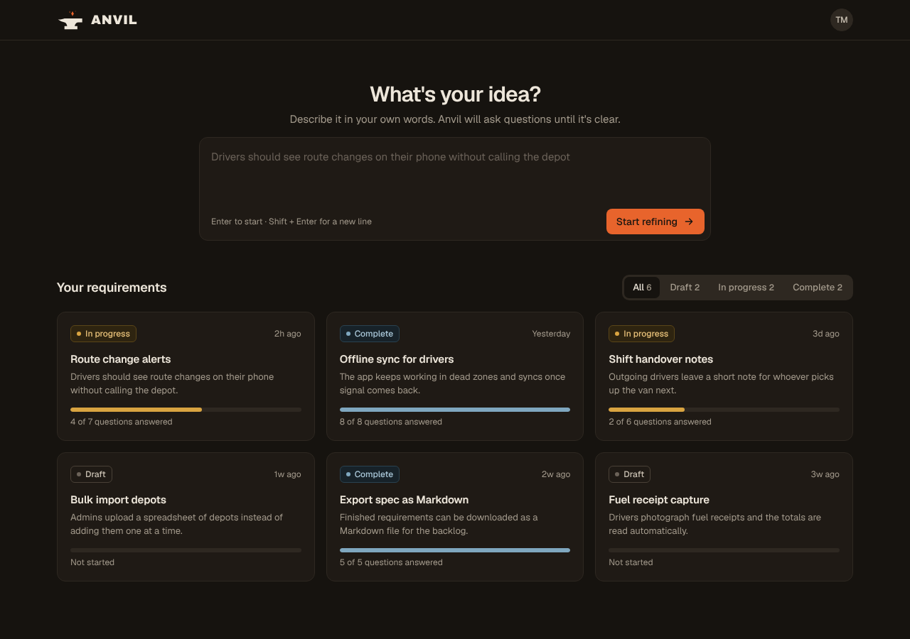
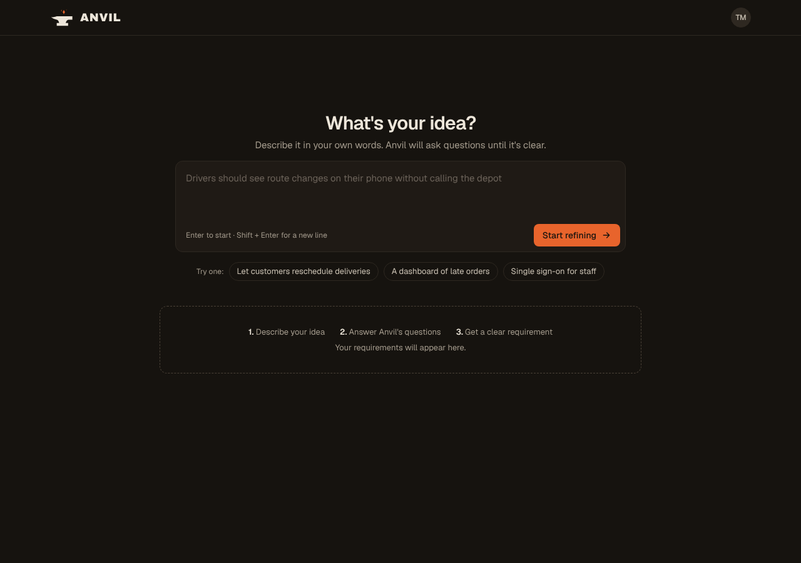
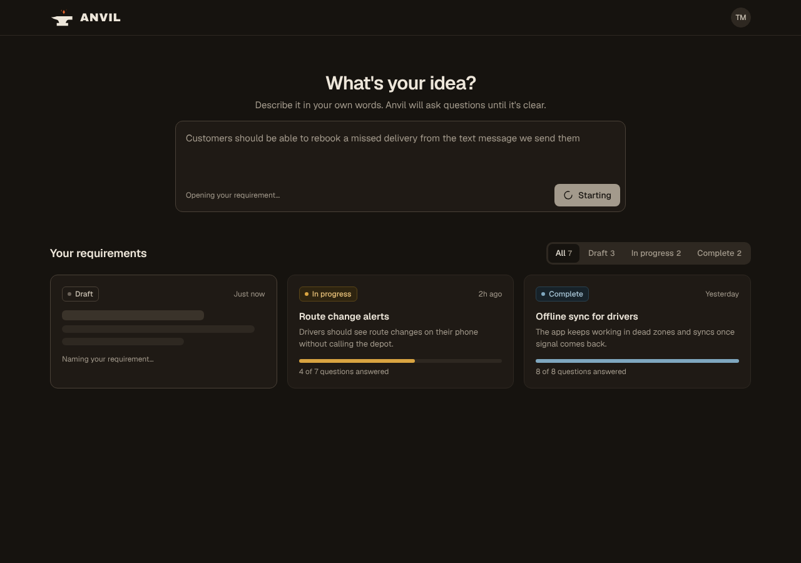

# Design

The source of truth for how Anvil looks. UI work should match this folder; when the design changes, update it here in the same PR.

The UI is built on [shadcn/ui](https://ui.shadcn.com) and Tailwind, dark mode only for now, themed with the **Forge** palette below.

## Logo

| File | Use |
|---|---|
| [`logo.svg`](logo.svg) | The main mark: an anvil with three sparks. Use it in the app header next to the wordmark. |
| [`favicon.svg`](favicon.svg) | The browser tab icon: the same anvil with a single spark. It switches the anvil to iron on light browser themes. |

The sparks are separate elements (`spark-1` to `spark-3`, hottest first) so they can be animated later. Don't merge them into one path.

**Wordmark:** `ANVIL` in Archivo, weight 900, letter-spacing `0.04em`, in ash. Sit the mark to its left, with a gap of about a quarter of the mark's width. The wordmark is the only place Archivo is used.

## Colour

Map these onto the shadcn CSS variables. Hex values are exact.

| Token | Hex | Name | Use |
|---|---|---|---|
| `--background` | `#16130F` | Iron | Page |
| `--card`, `--popover` | `#1F1A15` | | Cards, the idea prompt, menus |
| `--border`, `--input` | `#2E2821` | | Hairlines, field borders |
| `--muted`, `--secondary` | `#2B261F` | Soot | Tab list, progress track, avatar |
| `--foreground` | `#EDE6DA` | Ash | Text |
| `--muted-foreground` | `#A39A8C` | | Supporting text, timestamps |
| `--primary`, `--ring` | `#E8642C` | Ember | The one primary action per screen, and focus rings |
| `--primary-foreground` | `#16130F` | | Text on ember |

Keep ember for the primary action, focus and the logo's sparks. Don't use it for status.

### Status

Each status is a badge with a coloured dot, and the same colour fills the card's progress bar.

| Status | Dot and bar | Badge background | Badge border | Badge text |
|---|---|---|---|---|
| Draft | `#6B6259` | transparent | `#4A4137` | `#C9C0B2` |
| In progress | `#D9A441` | `#2E2410` | `#5A4518` | `#E9C27A` |
| Complete | `#7FA7BF` | `#172229` | `#2A4250` | `#A9C7D8` |

## Type

- **UI text:** [Geist](https://fonts.google.com/specimen/Geist), weights 400, 500 and 600.
- **Wordmark only:** [Archivo](https://fonts.google.com/specimen/Archivo), weight 900.

Sizes used on the home page: page heading 30px/600, section heading 18px/600, card title 15px/600, body 14–15px/400, captions and badges 12px/500.

## Shape and spacing

- Radius: 12px for cards and the prompt, 8px for buttons, 6px for badges, fully round for chips and the avatar.
- Content sits in a centred container, `max-width: 1120px`, with 24px side padding.
- Cards are flat: a border, no shadow.

## Wireframes

Screens for the v1 home page (spec #15). The data in them is made up.

| Screen | File |
|---|---|
| Your requirements |  |
| Your requirements, phone width | [home-requirements-mobile.png](wireframes/home-requirements-mobile.png) |
| First visit, no requirements yet |  |
| Just after submitting an idea |  |

The cards show question progress ("4 of 7 questions answered") to show where the design is heading. Until questions exist, every card shows an empty bar and "Not started".
